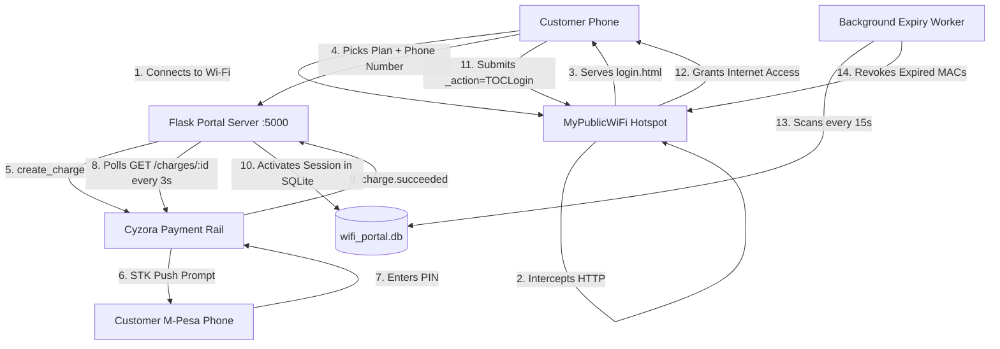

# WiFi Captive Portal with Cyzora M-Pesa & MyPublicWiFi

An automated, payment-driven captive portal system for Windows running **MyPublicWiFi** (virtual hotspot & native captive portal).

When customers connect to the Wi-Fi hotspot, they are automatically greeted by a mobile-optimized splash page, select an internet pass, receive an **M-Pesa STK Push** on their phone via **Cyzora**, enter their PIN, and automatically get full internet access without any manual intervention.

---

## 🌟 Key Features

- **Direct MyPublicWiFi Integration:** Zero extra software needed — links directly with the MyPublicWiFi installation on your Windows PC.
- **Mobile-First Splash Portal:** 100% offline-ready with pure HTML/CSS/JavaScript (zero CDN or external font dependencies, ensuring reliable rendering before internet access is unlocked).
- **Automated M-Pesa STK Push:** Integrated with the official Cyzora SDK (`cyzora`) with whole-shilling pricing and idempotency protection.
- **Pure Local Polling Architecture:** Polls payment status every 3 seconds locally — **no public IP, no DuckDNS, no port-forwarding, and no tunnels required**.
- **Automated Native Unlock:** Automatically submits MyPublicWiFi's native login token (`_action=TOCLogin`) upon payment confirmation to unblock the device instantly.
- **SQLite Session Management:** Tracks orders, phone numbers, MAC addresses, plan durations, and expiry timestamps in `wifi_portal.db`.
- **Background Expiry Worker:** Continuous daemon thread scanning every 15 seconds to monitor session lifetimes.
- **Reboot Resilience:** Includes Windows Task Scheduler installer and one-click batch launcher to survive system restarts.

---

## 📐 System Architecture



---

## 📂 Project Structure

```text
c:\Users\sam\Documents\wifihotspot\
│
├── config.json               # System configuration & data plans
├── .env                      # Cyzora credentials (CYZORA_SECRET_KEY)
├── app.py                    # Flask application & API routes
├── database.py               # SQLite database layer & audit logging
├── device_manager.py         # Client IP & Windows ARP MAC resolution
├── hotspot_manager.py        # MyPublicWiFi session manager & firewall hooks
├── session_manager.py        # Background thread for session expiry monitoring
├── requirements.txt          # Python dependencies
├── mypublicwifi_portal.html  # Branded portal template for MyPublicWiFi
├── wifi-captive-portal.md    # Task specification document
├── README.md                 # Documentation and operations guide
│
├── templates/
│   └── index.html            # Standalone portal splash page
│
├── static/
│   ├── css/
│   │   └── portal.css        # Responsive stylesheet (no external fonts)
│   └── js/
│       └── portal.js         # STK Push trigger & 3s polling engine
│
├── scripts/
│   ├── link_mypublicwifi.bat # One-click installer for MyPublicWiFi portal
│   ├── restore_mypublicwifi.bat# Restores original MyPublicWiFi login page
│   ├── start_hotspot.bat     # Windows master launcher with auto-restart
│   ├── stop_hotspot.bat      # Clean shutdown controller
│   ├── install_autostart.ps1 # Task Scheduler boot installer
│   └── uninstall_autostart.ps1# Task Scheduler uninstaller
│
└── tests/
    └── test_integration.py  # End-to-end integration test suite
```

---

## 🚀 Quick Setup Guide

### 1. Set Your Cyzora Key in `.env`
Open [.env](file:///c:/Users/sam/Documents/wifihotspot/.env) and enter your key:
```env
CYZORA_SECRET_KEY=sk_live_your_actual_key_here
CYZORA_WEBHOOK_SECRET=
CYZORA_BASE_URL=https://api.cyzora.co.ke/api/v1
```

### 2. Link MyPublicWiFi (One-Click)
Run [scripts/link_mypublicwifi.bat](file:///c:/Users/sam/Documents/wifihotspot/scripts/link_mypublicwifi.bat) (Run as Administrator):
- Adds firewall rule for port 5000.
- Backs up original `login.html` and installs the Cyzora payment portal.

### 3. Launch the Server
Run [scripts/start_hotspot.bat](file:///c:/Users/sam/Documents/wifihotspot/scripts/start_hotspot.bat):
- Starts MyPublicWiFi.
- Starts the Flask portal server on port 5000 with auto-restart protection.

### 4. Enable Auto-Start on Windows Boot (Optional)
Run in PowerShell (Admin):
```powershell
powershell -ExecutionPolicy Bypass -File "scripts\install_autostart.ps1"
```
